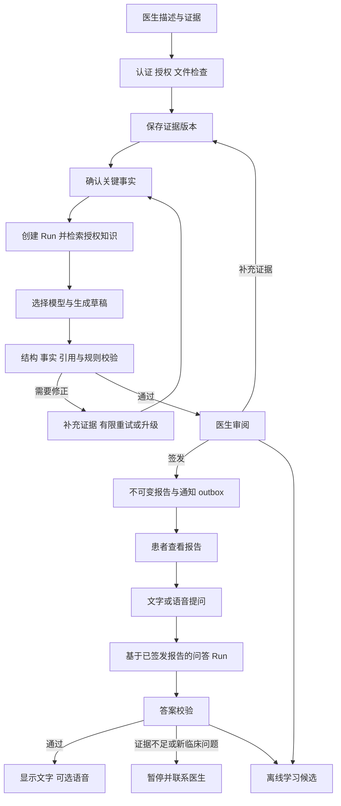
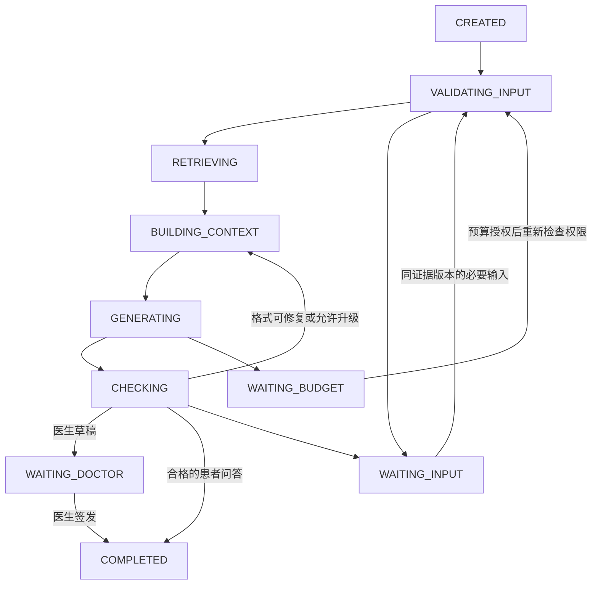

# Medical Agent：实验版开发设计

日期：2026-11-01。状态：待评审；需求已在讨论中收敛，接口与技术选型待实施验证。
本文描述计划，不表示产品已实现或已获得临床验证。

## 目标、范围与架构优先级

提供医生工作台和患者 App：医生提交描述、图片与证据，Agent 生成诊断方向和
报告草稿；医生补充证据、修改并签发报告；患者查看报告，通过文字或语音询问
术语及报告含义。每次诊疗产生学习候选，通过离线评测和审核后改进系统。

本场景采用**自建可信后端 Harness，直接调用模型**。参考 DSH 的调用控制点和
模型适配器，以及 Hermes 的会话/记忆分离，不要求整体部署任何外部 Harness。
本文评审接受后，在医疗实验范围内替代 landscape 的 OpenClaw 初始入口建议；
项目级隐私、授权、工具执行、持久化与离线学习边界继续有效。

实验默认：成人 2 型糖尿病的报告解释与医生辅助草稿；仅合成病例、模拟医生和
公开许可资料；本地开发。先交付响应式 Web/PWA，作为患者 App 的首个形式；
原生移动端后续复用业务 API。图片阶段先支持报告截图 OCR，不开放 CT/MRI、
病理或皮肤照片的临床诊断。通知、语音、图片按实施计划分阶段接入。

部署地区、真实患者授权、机构规则、临床负责人和图片模态验证必须在真实患者
试点前确定；这些不阻塞合成数据实验。无自动处方、自动改药或自主签发报告。

## 产品流程

医生草稿与患者问答使用不同权限和工具集合。患者不能访问未发布草稿；新症状
不悄悄改写已签发报告。遇到预定义紧急风险场景，展示经临床负责人批准的处置
提示并引导及时求助，不等待普通医生消息回复。

## 模块与建议实现结构

初始建议：Python 类型化业务服务、HTTP API、独立 worker、PostgreSQL 事务与
持久化任务表、私有文件存储；前端 TypeScript。具体框架、版本和部署在 M0 ADR
固定。首版用一个流程执行者，不建设多智能体协调或独立消息集群。

- `PolicyService`：身份、机构、患者诊疗关系、数据范围和行为权限。
- `PrivacyGateway` / `TokenVault`：最小化模型输入，不透明患者引用，隔离映射。
- `KnowledgeSource`：外部资料连接器；`KnowledgeService`：授权检索、版本和引用。
- `RunStore`：状态、证据快照、检查点、租约和乐观锁版本。
- `BudgetService`：任务及租户预算的原子预留、结算、未知用量对账。
- `Router`：根据任务、模态、失败类别、质量策略和剩余额度选择模型。
- `ModelProvider`：统一请求、结果、错误、取消与用量契约。
- `AnswerValidator`：结构、来源支持、事实一致性、临床规则与输出隐私检查。
- `ReportService`：医生签发、修订、撤销可见性、审计和通知 outbox。
- `SpeechService`：语音识别与合成适配器；只合成已通过校验的答案。
- `EvaluationService` / `ReleaseService`：离线评测、审核、版本发布和回滚。

Web/App 只调用业务 API。提供方凭据由后端持有。运行进度可以流式传递，但
未经校验的答案正文不发送患者端；第三方模型输出必须先完成后端校验。

## 数据契约与版本

所有临床资源绑定 tenant 和权限范围；服务端从认证上下文确定 principal，
不信任客户端传入的 tenant、患者归属或医生角色。

- `Encounter`：患者引用、诊疗团队、状态、当前 evidence_version。
- `Evidence`：不可变版本、来源、时间、作者、原件引用/摘要、模态、确认状态。
  原始报告、医生确认事实与模型推测分别存储，模型推测不能自动成为事实。
- `Run`：tenant、encounter、purpose、evidence_version、报告版本（患者问答）、
  agent_release、knowledge_version、route_policy、状态、step、attempt、
  budget_ref、lease_owner、lease_expiry、state_version、结果引用。
- `CandidateReport`：关联 Run、证据版本、结构化内容、引用、校验结果、内容摘要。
- `SignedReport`：不可变正文、医生、签发时间、证据版本、草稿摘要、修订关系。
- `KnowledgeDocument` / `Chunk`：源 ID、许可证、修订/内容 hash、适用范围、
  文献类型、发布日期、抓取时间、可定位段落和撤回/删除状态。
- `ModelRequest`：model、messages、output_schema、max_output_tokens、timeout。
- `ModelResult`：结构化内容、input/output usage、provider_request_id、finish_reason。
  缺失 usage 明确标记 unknown；截断不能按完成结果签发。
- `BudgetReservation`：账户、Run/attempt、费用上界、定价版本、状态、实际用量。
- `AuditEvent` / `OutboxEvent`：不透明资源引用、行为、版本、幂等键和状态。
- `LearningCandidate`：来源事件引用、授权状态、问题归因、候选变更、审核状态。
- `AgentRelease`：知识、提示词、模型配置、路由、校验规则、代码与评测版本。

可参考 FHIR DiagnosticReport、Observation、ImagingStudy 做字段映射；首版不
宣称 FHIR 兼容，医院接入时再固定 FHIR 版本和实施指南。

## Run 状态机与恢复

所有非终态均可经服务端规则进入 CANCELLED；不可恢复错误进入 FAILED。
工具/提供方结果未知记录在 attempt 子状态 UNKNOWN，暂停自动重复调用，待对账
或人工处理；不能用一个失败标志覆盖可能已发生的费用或副作用。

本医疗实验的 WAITING_BUDGET 是参考架构通用等待状态的细化，需要在首个状态
schema 中显式定义。等待期间不持有数据库事务。医生补充临床证据创建新版本和
新 Run；旧 Run 标记过期原因并取消，旧候选保留但禁止签发。

允许转换由代码中的白名单管理。每次转换原子检查 state_version、租约 fencing
标记和当前证据版本。过期 worker 不能提交状态、签发或触发新副作用。worker
重启后恢复检查点；租约避免双执行者，但不能保证外部提供方恰好执行一次。

校验失败分类：缺证据进入 WAITING_INPUT；可修复格式只重试有限次数；能力不足
可升级；权限/隐私失败立即停止。attempt 上限和预算是代码规则，模型不可修改。

## 预算与模型路由

顺序：授权 → 检索/上下文 → 路由 → 原子预留 → 调用 → 结算 → 保存候选 → 校验。
路由初期采用可解释规则，不使用模型自报信心作为可靠指标。复杂临床任务可直接
选择通过该任务评测的模型，不强制所有任务先调用便宜模型。

每个 provider 调用包括重试、摘要、模型校验、语音及付费工具均受相应费用策略
约束。原子检查任务和租户余额，预留保守上界；价格未知或账本不可用时拒绝新
付费调用。流式取消、网络超时或崩溃时保留未确认预留并对账，不能视为零费用。
无法获取提供方状态时进入人工核对，不自动重复昂贵请求。

跨模型切换从结构化事实、授权证据与任务重新构建上下文，不直接复制专属推理
状态或不兼容工具历史。缓存按租户/权限、证据、报告、知识及策略版本隔离。

货币成本、累计 Token、上下文窗口、速率和延迟分别计量。内部预算限制与外部
账单存在计费延迟/误差，需保守余量；不承诺外部账单绝对零超支。

## PMC 首个连接器与可替换知识源

采用 PMC Open Access Subset，先筛选成人 2 型糖尿病相关资料的小规模集合。
初始目标 50–100 篇是采集规模建议，不是准确率保证；数量可依许可和相关性调整。
优先可复用的指南/综述，排除预印本和已撤回资料；逐篇记录许可证，不能将开放
访问等同于任意用途授权。商业化前重新核对使用范围和第三方内容许可。

`KnowledgeSource` 暴露 `search`、`fetch`、`get_revision`，返回标准化 Document；
支持分页、限流、重试和明确错误。PMC 只使用官方允许的自动获取渠道，例如
E-utilities 或 BioC；依据当时官方配额配置节流，不爬取网页绕过限制。

原文 snapshot → 文档类型/许可审核 → 分段 → 索引 → 原子发布 knowledge_version。
抓取未完成的版本不服务查询；保存引用锚点、hash 与来源链接。数据库查询只发送
经最小化的检索词，不发送患者姓名或原始报告。撤回/撤权立即使相关缓存失效；
历史来源受限时返回不可用标记，不为保留历史而绕过撤销。

后续替换医院/商业数据库时新增适配器并重建索引；以同一评测集重新检查召回、
引用、时效和领域适用性。PMC 是文献源，不是患者记录库或诊断真值。

## 医生签发与患者交付

签发是独立业务事务，模型没有签发工具。认证医生提交草稿 ID、期望版本和内容
摘要，服务端重新检查诊疗权限、当前证据版本、草稿校验结果和摘要一致性，然后
同一事务内创建 SignedReport、写入审计及 outbox。相同幂等键返回相同结果。

新证据使旧草稿无法签发，返回冲突并要求重新运行。已签发正文不可覆盖；更正
建立新版本并保留修订关系。outbox 通知幂等重试，锁屏通知不包含诊断正文。
患者每次读取重新授权，只返回准许发布版本及修订状态。

患者问答固定报告版本；问答期间报告更新时，交付前复核并要求基于新版本重新
生成或明确旧版来源。问答可解释术语和已确认医嘱，不自主新增治疗、处方或改药。
回答中未知、证据冲突和超范围信息明确说明，并提供医生联系路径。

## 图片、语音与数据保护

报告截图先检查类型、大小、恶意文件、清晰度和患者归属；OCR 生成待确认字段。
数值、单位、否定词和时间由医生确认后进入事实集合。不能把 OCR 置信度当成
医学判断可靠性。其他医学影像在模态专项评测前保持关闭。

语音输入先展示转写，关键药名、剂量、数字和否定词支持确认。语音合成只接受
带通过状态及 hash 的答案；文本与音频绑定同一版本。测量医学实体错误率而不
只看整体识别率。失败回退文字，取消后停止播放和后续合成。

私有文件、录音和临床记录加密并按授权访问；外部 STT/TTS 同样经过数据处理
权限检查。原始音频默认短期/不持久化，具体保留期在真实数据 ADR 中确认。
普通日志和审计只记录引用、状态与用量；所有实验 fixture 必须为合成内容。
患者记录删除/撤权传播至索引、摘要、缓存、派生音频和学习候选；法定保留冲突
在真实部署前明确，不静默宣称所有副本已删除。

## Self-improve 与发布

每次事件可产生候选，不即时改变生产行为。分离会话历史、患者偏好、临床事实
和全局知识。医生接受草稿不是正确性真值；修订、最终诊断和随访结果分别标注。

候选归因 → 授权与去标识 → 资料/检索/提示/路由改进 → 独立留出集评测 →
临床与工程审核 → 影子运行 → 小范围发布 → 监测 → 扩大或回滚。

初期不训练模型权重。评测按患者/事件族划分，避免同源问题泄漏；固定知识快照，
记录模型版本和价格。真实个人数据不进入源码、普通日志或评测数据集。

发布单元是不可变 AgentRelease；正在运行的 Run 固定版本，新版本只影响新 Run。
回滚原子切换新 Run 的 release 指针，不恢复已删除知识、不重写已签发报告。
紧急撤权优先于版本固定，受影响 Run 必须停止或重新授权。

## 迁移、运行与验证边界

M0 建立 schema 版本和迁移命令，采用新增字段/兼容读取，再迁移写入的策略。
部署前验证旧数据读取、备份恢复和应用回滚；不通过删除历史报告回退 schema。
单机原型也要持久化状态与预算；worker 进程和 API 分离，数据库为权威状态。

指标：任务合格率、严重错误、引用支持率、合理拒答、医生修改量、p95 延迟、
全部尝试费用/合格任务数、预算拒绝和未知用量。合格任务为零时单位成本不报告
为有限值。评测费用和推理费用分开报告，避免隐藏验证开销。

研发计划与逐项验收见 [实施与验证计划](../plans/medical-agent-implementation.zh-CN.md)。
本次仅文档，无 schema、依赖、部署变化；撤销本次文档即可回滚。

## 来源与事实边界

- [PMC Open Access Subset](https://pmc.ncbi.nlm.nih.gov/tools/openftlist/)：许可与允许的自动获取渠道。
- [NCBI API](https://www.ncbi.nlm.nih.gov/home/develop/api/)：E-utilities、PMC API 入口。
- [FHIR 诊断模块](https://fhir.hl7.org/fhir/diagnostics-module.html)：报告、观察和影像关联参考。
- [WHO 医疗多模态模型治理](https://www.who.int/publications/i/item/9789240084759)：监督、评估与治理背景。
- [DSH 生命周期](https://github.com/deepseek-ai/deepseek-harness/blob/master/docs/agent-lifecycle.md)：参考调用控制点。
- [DSH 模型契约](https://github.com/deepseek-ai/deepseek-harness/blob/master/docs/subsystems/llm-streaming.md)：适配器与冻结请求边界。
- [Hermes 程序化接入](https://hermes-agent.nousresearch.com/docs/developer-guide/programmatic-integration)：会话与接入参考。
- [Hermes 记忆](https://hermes-agent.nousresearch.com/docs/user-guide/features/memory)：记忆行为参考，不等于受控临床学习。

上述来源于 2026-11-01 研究。模块选择、状态、阈值与发布机制是本项目设计建议；
不是外部项目的质量承诺。复用代码前固定提交并检查许可证，不依赖可变 main。
